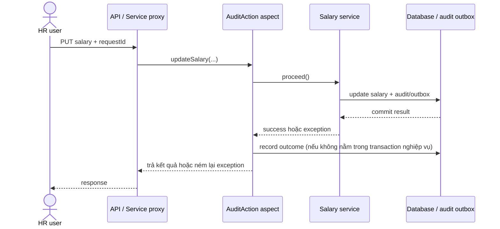
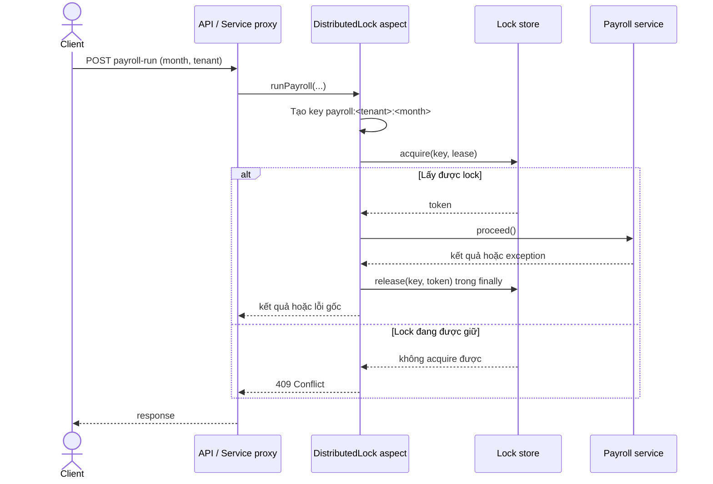

# 03 — Spring AOP Design

## 1. `@AuditAction`

**Mục đích:** ghi nhận metadata cho thao tác nghiệp vụ quan trọng, ví dụ cập nhật salary. Aspect chỉ lo cross-cutting audit; không quyết định nghiệp vụ có được phép cập nhật hay không.

- **Pointcut:** method execution của service method có `@AuditAction`, chẳng hạn `EmployeeSalaryService.updateSalary`. Tránh áp dụng rộng cho mọi method hoặc controller.
- **`@Around` advice:** đọc annotation và lấy actor/correlation ID; gọi `proceed()` để chạy method gốc; ghi kết quả `SUCCESS` nếu thành công. Nếu method ném exception, ghi `FAILURE` cùng mã/loại lỗi an toàn rồi ném lại exception gốc. Không nuốt exception hoặc ghi salary/request payload nhạy cảm vào log.
- **Audit fields:** `eventId`, `action`, `actorId`, `tenantId`, resource type/id, timestamp UTC, outcome, reason/error code, `requestId`/`correlationId`, source IP nếu chính sách cho phép. Giá trị trước/sau chỉ lưu ở audit domain có kiểm soát truy cập, không nhét nguyên request vào application log.
- **Độ tin cậy:** nếu audit là yêu cầu tuân thủ, không được âm thầm bỏ qua lỗi ghi audit. Cân nhắc ghi audit cùng transaction hoặc transactional outbox để tránh cập nhật thành công nhưng audit thất bại; không tạo side effect audit trùng khi retry.

## 2. `@DistributedLock`

- **Pointcut:** method có `@DistributedLock`, giới hạn vào tác vụ cần loại trừ đồng thời, ví dụ chạy payroll theo tháng/tenant. Không dùng lock như thay thế transaction hoặc authorization.
- **Tạo key:** resolve biểu thức SpEL trên tham số method trước khi gọi method gốc. Với `key = "'payroll:' + #request.month"`, chuẩn hóa thành `payroll:<tenantId>:<YYYY-MM>`; nên đưa tenant vào key để tránh khóa chéo tenant. Validate giá trị, giới hạn độ dài và không đưa dữ liệu cá nhân vào key.
- **`@Around` advice:** tạo key, thử acquire lock atomic với lease/TTL hữu hạn; chỉ gọi `proceed()` khi lấy được. Release trong `finally`, chỉ chủ sở hữu lock mới được release. Dùng fencing token hoặc cơ chế tương đương nếu hệ thống cần chống tiến trình cũ tiếp tục ghi sau khi lease hết hạn.
- **Không lấy được lock:** với request trùng đang chạy, trả `409 Conflict` kèm thông báo có thể thử lại; nếu lock service unavailable thì trả `503 Service Unavailable`. Có thể chọn `423 Locked` nếu API convention quy định, nhưng cần thống nhất.
- **Exception/timeout:** ném lại lỗi gốc; release lock trong `finally`. Lease phải đủ dài hoặc được gia hạn an toàn cho tác vụ dài; timeout không được làm hai tiến trình cùng ghi mà không có fencing/idempotency.

## 3. Rủi ro khi lạm dụng AOP

- Luồng điều khiển bị ẩn, khó lần theo khi debug; gọi nội bộ trong cùng bean có thể bỏ qua Spring proxy/advice.
- Pointcut quá rộng có thể gây audit/lock ngoài ý muốn hoặc ảnh hưởng hiệu năng.
- `@Around` quên gọi `proceed()` làm method gốc không chạy; gọi nhiều lần có thể chạy nghiệp vụ lặp.
- Thứ tự aspect, transaction và audit không rõ có thể ghi sai outcome hoặc audit không nhất quán.
- Distributed lock có thể hết lease sớm, không release, deadlock logic hoặc tạo bottleneck; cần timeout, quan sát và fencing/idempotency phù hợp.
- Không đặt business rule, quyết định lương/thuế hoặc workflow quan trọng ẩn trong aspect; giữ chúng explicit trong service.
