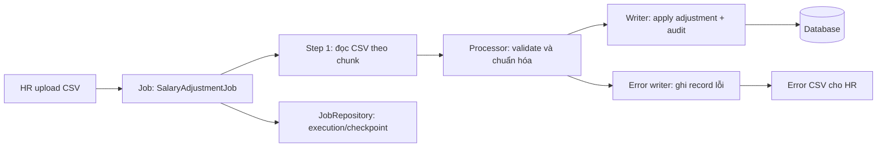

# 06 — Spring Batch Design: Salary Adjustments

## Bài toán

HR upload CSV khoảng 3 triệu dòng mỗi tháng:

```text
employee_id, effective_date, adjustment_type, amount
```

## 1. Job và flow



Dùng `FlatFileItemReader`, processor validate employee, ngày hiệu lực, loại adjustment, amount và quyền/phạm vi file; writer áp dụng các record hợp lệ. Có thể tách staging/validation khỏi bước apply nếu cần HR xem trước kết quả trước khi ghi salary.

## 2. Chunk size

Bắt đầu thử nghiệm với **500 records/chunk**. Đây là điểm khởi đầu, không phải con số cố định: chunk nhỏ giảm transaction dài và lượng công việc phải làm lại; chunk lớn giảm overhead commit nhưng tăng memory, thời gian transaction và lock contention. Benchmark trên dữ liệu/DB gần production, sau đó điều chỉnh theo throughput, commit latency, memory và lock wait.

## 3. Skip và retry policy

- **Skip có kiểm soát:** lỗi dữ liệu không thể sửa tự động như employee ID không tồn tại, ngày/amount sai định dạng, adjustment type không hợp lệ; ghi row number, giá trị cần thiết, error code và message vào error output.
- **Retry giới hạn:** lỗi tạm thời như deadlock/serialization conflict hoặc lỗi kết nối DB có thể retry với backoff và số lần giới hạn.
- **Không retry mù quáng:** lỗi validation/business permanent không retry; lỗi vượt quá retry policy làm step/job fail để có thể điều tra và restart.
- Thiết lập skip limit/tỷ lệ lỗi tối đa; nếu vượt ngưỡng, dừng job và yêu cầu HR xử lý thay vì âm thầm bỏ qua quá nhiều dòng.

## 4. Idempotency và audit

- Tạo `source_file_id` ổn định từ checksum file + tenant + kỳ lương; lưu file/job metadata và row number trong staging.
- Đặt unique constraint trên idempotency key của adjustment. Nếu domain đảm bảo mỗi employee chỉ có một adjustment cho cùng `effective_date` và `adjustment_type`, có thể dùng khóa nghiệp vụ đó; nếu không, tạo adjustment ID ổn định khi ingest và dùng khóa ấy. Xác định rõ quy tắc duplicate với HR.
- Khi restart cùng file, record đã apply không được apply lần nữa; writer có thể upsert/check idempotency key.
- Ghi salary change và audit event trong cùng transaction/chunk, hoặc ghi transactional outbox; lưu actor/uploader, tenant, file ID, row number, thời điểm và before/after cần thiết.

## 5. Restart và recovery

1. JobRepository lưu JobInstance/JobExecution, StepExecution và checkpoint; khởi chạy lại cùng identifying parameters để tiếp tục cùng JobInstance.
2. Reader cần restartable và dùng ổn định file input; lưu file bất biến theo file ID/checksum, không thay nội dung giữa lần chạy.
3. Mỗi chunk commit nguyên tử; sau failure, tiếp tục từ checkpoint gần nhất. Idempotency/unique constraint bảo vệ trường hợp retry hoặc record đã commit nhưng trạng thái được báo chưa rõ.
4. Job thất bại sau khi vượt retry/skip threshold: giữ file và execution metadata, tạo error report, cho phép operator/HR sửa dữ liệu rồi chạy lại theo quy trình được kiểm soát.
5. Không dùng cùng identifying parameters cho một file đã sửa nội dung; tạo file/job version mới và liên kết với lần upload ban đầu.

## 6. Error file cho HR và vận hành

Xuất CSV lỗi có `row_number`, `employee_id` nếu parse được, `effective_date`, `adjustment_type`, `amount`, `error_code`, `error_message`. Không đưa dữ liệu nhạy cảm ngoài nhu cầu xử lý. Báo cáo cuối job gồm tổng số đọc, thành công, skip, retry và lỗi; giới hạn quyền tải file và đặt retention.

Theo dõi thêm: records/sec, chunk/commit duration, job duration/status, retry/skip count, DB pool wait, lock/deadlock, heap/GC, và số dòng đang chờ xử lý.
