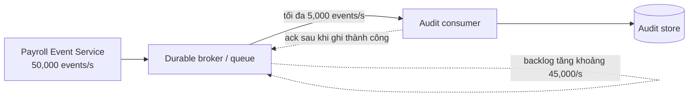

# 04 — Reactive Fundamentals: Mono, Flux, Non-blocking và Backpressure

## 1. Mục tiêu

Sau bài này, có thể:

- Phân biệt lập trình đồng bộ/blocking với bất đồng bộ/non-blocking; hiểu non-blocking không đồng nghĩa với xử lý nhanh hơn.
- Giải thích các thành phần của Reactive Streams: `Publisher`, `Subscriber`, `Subscription` và demand.
- Chọn `Mono<T>` hoặc `Flux<T>` phù hợp.
- Mô tả backpressure và chọn chính sách khi producer nhanh hơn consumer.
- Nhận biết dữ liệu nào có thể bỏ, dữ liệu nào phải được lưu và xử lý đầy đủ.

## 2. Reactive Manifesto

Reactive Manifesto mô tả các đặc tính của một hệ thống reactive:

- **Responsive (đáp ứng):** phản hồi kịp thời, kể cả khi hệ thống gặp tải hoặc lỗi.
- **Resilient (chịu lỗi):** duy trì dịch vụ hoặc phục hồi có kiểm soát khi một thành phần gặp sự cố.
- **Elastic (co giãn):** điều chỉnh tài nguyên theo tải thay vì phụ thuộc vào một mức tải cố định.
- **Message-driven (hướng thông điệp):** các thành phần giao tiếp bất đồng bộ qua thông điệp, giúp giảm phụ thuộc trực tiếp và cô lập lỗi.

Reactive không chỉ có nghĩa là dùng `Mono` hoặc `Flux`. Đây là cách thiết kế hệ thống để quản lý giao tiếp, tải và lỗi một cách rõ ràng.

## 3. Blocking và non-blocking

### Blocking

Một thread gọi thao tác I/O và chờ cho đến khi thao tác hoàn tất. Trong thời gian chờ, thread đó thường không thể làm công việc khác.

```text
Request A -> thread chờ database
Request B -> cần thread khác
Request C -> cần thread khác
```

### Non-blocking

Thay vì giữ thread để chờ I/O, chương trình đăng ký việc cần làm tiếp theo. Khi dữ liệu hoặc kết quả sẵn sàng, callback hoặc reactive pipeline được tiếp tục.

```text
Gửi yêu cầu I/O -> thread có thể xử lý việc khác
I/O hoàn tất -> tiếp tục pipeline với kết quả
```

Non-blocking **không có nghĩa là một truy vấn database tự chạy nhanh hơn**. Nó có thể giúp sử dụng thread và tài nguyên hiệu quả hơn khi có nhiều thao tác I/O đồng thời. Thời gian xử lý vẫn phụ thuộc vào database, mạng, CPU, thiết kế và tải.

> Không nên gọi API blocking trong một luồng xử lý reactive mà không có chủ đích. Làm vậy có thể chiếm thread của event loop và làm giảm khả năng đáp ứng.

## 4. Reactive Streams: Publisher, Subscriber, Subscription, demand

Reactive Streams định nghĩa giao thức trao đổi dữ liệu bất đồng bộ có thể điều tiết demand:

- **Publisher:** phát ra các item hoặc thông báo hoàn tất/lỗi.
- **Subscriber:** nhận các item.
- **Subscription:** cầu nối giữa hai bên; cho phép Subscriber yêu cầu thêm item (`request(n)`) hoặc hủy đăng ký (`cancel()`).
- **Demand:** số lượng item Subscriber sẵn sàng nhận tại thời điểm đó.

Luồng khái quát:

```text
Subscriber -- subscribe() --> Publisher
Subscriber <-- onSubscribe(Subscription) -- Publisher
Subscriber -- request(n) --> Subscription
Publisher -- onNext(item) --> Subscriber  (tối đa theo demand)
Publisher -- onComplete() hoặc onError() --> Subscriber
```

Producer không nhất thiết phải phát toàn bộ dữ liệu ngay lập tức. Subscriber có thể điều tiết lượng dữ liệu yêu cầu. Đây là nền tảng của backpressure.

## 5. `Mono<T>` và `Flux<T>`

Trong Project Reactor, cả `Mono<T>` và `Flux<T>` đều là reactive types triển khai `Publisher`:

```text
Mono<Employee> = có thể phát 0 hoặc 1 Employee
Flux<Employee> = có thể phát 0 đến N Employee
```

Chọn theo số lượng kết quả có thể phát ra, không phải theo việc dữ liệu có đồng bộ hay không:

- Dùng `Mono<T>` cho một kết quả có thể vắng mặt, ví dụ tìm một nhân viên theo ID hoặc lưu một bản ghi và nhận kết quả.
- Dùng `Flux<T>` cho một tập hợp hoặc luồng nhiều kết quả, ví dụ đọc các nhân viên hoặc nhận các sự kiện.

`Flux` **không đồng nghĩa với việc tải tất cả dữ liệu vào memory**. Nó biểu diễn một chuỗi item. Việc tiêu thụ có thể diễn ra từng item và demand có thể được điều tiết. Tuy nhiên, operator hoặc cấu hình như `collectList`, `buffer`, `cache` hay một hàng đợi có giới hạn không phù hợp vẫn có thể tích lũy dữ liệu trong memory. Cần kiểm tra cách tạo nguồn và từng operator trong pipeline.

## 6. Một số operators thường gặp

| Operator | Ý nghĩa | Ví dụ sử dụng |
|---|---|---|
| `map` | Biến đổi đồng bộ từng item | Chuyển `Employee` thành DTO |
| `flatMap` | Biến đổi mỗi item thành một Publisher khác và hợp nhất kết quả bất đồng bộ | Với mỗi nhân viên, gọi dịch vụ khác |
| `filter` | Chỉ giữ item thỏa điều kiện | Chỉ xử lý sự kiện thuộc một tenant |
| `zip` | Kết hợp kết quả từ nhiều nguồn theo item tương ứng | Ghép hồ sơ nhân viên với thông tin phòng ban |
| `timeout` | Phát lỗi nếu không có kết quả trong thời hạn | Giới hạn thời gian chờ dịch vụ phụ thuộc |
| `retry` | Đăng ký lại khi gặp lỗi theo điều kiện/cấu hình | Thử lại lỗi tạm thời |

Lưu ý: `flatMap` có thể cho phép nhiều thao tác đồng thời; cần giới hạn concurrency nếu dịch vụ downstream không chịu được tải cao. `retry` có thể gây xử lý lặp, nên thao tác cần idempotent hoặc có cơ chế chống trùng. Không retry vô hạn mọi loại lỗi.

## 7. Backpressure

Backpressure là cơ chế consumer/downstream báo lượng dữ liệu nó sẵn sàng nhận, để producer/upstream có thể điều chỉnh tốc độ khi giao thức và nguồn dữ liệu hỗ trợ điều đó.

```mermaid
flowchart LR
    P[Producer] -->|phát events| S[Stream / Publisher]
    S -->|tối đa theo demand| C[Consumer]
    C -.->|request(n): cần thêm n item| S
    S -.->|điều tiết demand| P
```

Ví dụ đơn giản:

```text
Producer tạo: 100,000 events/second
Consumer xử lý ổn định: 10,000 events/second
```

Nếu dữ liệu tiếp tục đến nhanh hơn khả năng xử lý mà không có chính sách giới hạn, hàng đợi có thể tăng dần, dẫn đến memory tăng, latency kéo dài, dữ liệu hết hạn hoặc mất dữ liệu khi ứng dụng quá tải/crash.

Backpressure không tự giải quyết mọi trường hợp. Một nguồn nóng (hot source), hệ thống ngoài, hoặc broker có thể không dừng phát theo demand của một subscriber. Khi đó phải cấu hình rõ buffer, giới hạn, queue, drop hoặc cơ chế điều tiết ở tầng nguồn/broker.

## 8. Scenario: Payroll Event Service và Audit consumer

### Tình huống

- Payroll Event Service phát `50,000` employee-change events/second.
- Audit consumer xử lý ổn định `5,000` events/second.
- Chênh lệch là `45,000` events/second.



Nếu hệ thống tiếp tục hoạt động ở các tốc độ này, backlog tăng xấp xỉ:

- `45,000` events mỗi giây.
- `2,700,000` events mỗi phút.
- `162,000,000` events mỗi giờ.

Đây là mức tăng lý thuyết, chưa tính retry, kích thước event, thời gian xử lý biến động hoặc khả năng tăng consumer. Nếu không giới hạn, hàng đợi cuối cùng sẽ hết dung lượng; nếu không lưu bền vững, dữ liệu có thể mất khi tiến trình dừng.

### Rủi ro khi không có backpressure hoặc buffering policy

1. **Memory tăng không giới hạn:** buffer trong tiến trình phình to và có thể gây `OutOfMemoryError`.
2. **Latency tăng:** audit đến muộn, khiến việc điều tra và đối soát không còn kịp thời.
3. **Mất sự kiện:** crash, restart hoặc queue đầy có thể làm mất item chưa xử lý nếu không được lưu bền vững.
4. **Retry storm:** nhiều lần thử lại đồng thời làm tăng tải lên consumer hoặc dependency đang gặp sự cố.
5. **Ảnh hưởng dây chuyền:** consumer chậm có thể gây cạn thread, connection, disk hoặc làm chậm các dịch vụ khác.
6. **Khó khôi phục:** không có offset/acknowledgement hoặc khả năng replay thì khó xác định sự kiện nào đã được xử lý.

### Chọn chính sách phù hợp

| Chính sách | Khi nào phù hợp | Lưu ý |
|---|---|---|
| **Drop** | Dữ liệu phụ, có thể tính lại hoặc chỉ mang tính quan sát, ví dụ một số metric/telemetry | Chỉ drop khi nghiệp vụ chấp nhận mất dữ liệu; ghi nhận số lượng bị drop và cảnh báo |
| **Buffer giới hạn** | Chịu được burst ngắn và muốn hấp thụ dao động tạm thời | Đặt giới hạn dung lượng; quy định hành vi khi đầy (reject, drop, spill to disk); buffer chỉ trì hoãn vấn đề nếu tốc độ dài hạn không cân bằng |
| **Retry có giới hạn** | Lỗi tạm thời như timeout hoặc dịch vụ downstream tạm unavailable | Dùng backoff, giới hạn số lần thử và dead-letter/quarantine; tránh retry lỗi vĩnh viễn và bảo đảm idempotency |
| **Durable queue / broker** | Sự kiện nghiệp vụ phải được lưu, xử lý lại được và producer/consumer cần độc lập về tốc độ | Theo dõi backlog, tuổi sự kiện, dung lượng và chính sách retention; ack sau khi xử lý thành công |
| **Điều tiết producer** | Producer có thể giảm tốc hoặc phát theo quota/demand | Đây là cách tốt để không tạo backlog liên tục nếu nghiệp vụ cho phép |
| **Scale consumer** | Có thể tăng số consumer/partition và công việc xử lý song song an toàn | Chỉ hiệu quả nếu có đủ tài nguyên và thứ tự/idempotency được xử lý đúng |

### Đề xuất cho audit events

Audit event về thay đổi nhân viên/payroll thường là dữ liệu tuân thủ và điều tra, vì vậy **không nên drop**. Một chiến lược điển hình:

1. Payroll service ghi/publish event qua durable broker (có thể dùng transactional outbox để giảm nguy cơ cập nhật dữ liệu thành công nhưng phát event thất bại).
2. Audit consumer đọc theo tốc độ có thể xử lý; giới hạn concurrency để bảo vệ audit store.
3. Chỉ acknowledgement sau khi ghi audit thành công.
4. Với lỗi tạm thời, retry có backoff và giới hạn; với lỗi không thể xử lý, chuyển dead-letter/quarantine để điều tra và replay.
5. Dùng event ID/idempotency key để consumer xử lý lặp an toàn.
6. Đặt cảnh báo theo backlog, tuổi event cũ nhất, tỷ lệ lỗi, retry và dung lượng còn lại. Nếu backlog tăng kéo dài, cần tăng năng lực consumer, giảm tốc producer hoặc bổ sung dung lượng; queue không thể hấp thụ chênh lệch vô hạn.

## 9. Dữ liệu nào không được drop?

Thông thường không được drop các sự kiện cần cho:

- Audit trail, thay đổi lương, thay đổi trạng thái nhân viên và hành động phê duyệt.
- Tính lương, thanh toán, hoàn tiền hoặc giao dịch có ảnh hưởng tài chính.
- Bằng chứng phục vụ tuân thủ, phân quyền và điều tra sự cố.
- Các sự kiện mà hệ thống downstream cần để giữ trạng thái nhất quán.

Có thể cân nhắc drop dữ liệu quan sát không thiết yếu, dữ liệu trùng có thể loại bỏ an toàn, hoặc snapshot có thể tạo lại — nhưng chỉ khi yêu cầu nghiệp vụ xác nhận điều đó. “Không drop” cũng không có nghĩa là giữ dữ liệu vô thời hạn: cần retention, kiểm soát truy cập, mã hóa và quy định lưu trữ phù hợp.